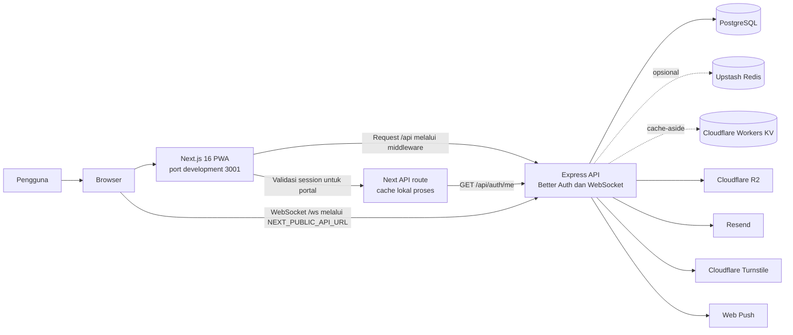

# Catatan Arsitektur dan Infrastruktur

Catatan ini merangkum konfigurasi yang ada di repositori server dan client. Catatan ini menjelaskan apa yang didefinisikan kode dan file proyek; keberadaan konfigurasi tidak membuktikan bahwa suatu layanan sedang aktif di lingkungan produksi.

## Gambaran arsitektur

Client menyajikan UI per role. Middleware Next.js memeriksa session sebelum membuka portal dan meneruskan request `/api/*` ke backend. Route validasi session di client memanggil `/api/auth/me` pada backend ketika cache lokalnya tidak memiliki hasil. Untuk operasi data, server Express memeriksa session, role, validasi request, dan CSRF sebelum memanggil controller, service, repository, lalu Drizzle/PostgreSQL.

Server membuka HTTP API dan WebSocket pada listener yang sama. PostgreSQL menyimpan data aplikasi dan metadata media; file media dikirim ke R2. Cloudflare Workers KV menyimpan cache katalog dan ketersediaan slot. Integrasi eksternal lain mencakup email Resend, CAPTCHA Turnstile, Redis opsional, dan Web Push berbasis VAPID.

## Infrastruktur yang didefinisikan repo

| Area | Kondisi saat ini |
| --- | --- |
| Runtime server | Bun 1.4.4, Express 5, TypeScript. HTTP API dan WebSocket `/ws` berjalan dalam satu proses server. |
| Runtime client | Bun 1.4.4, Next.js 16.4.3, React 19.3.1. Skrip development memakai port `3001`. |
| Database lokal | Podman Compose menjalankan `postgres:18-alpine`, volume persisten, dan health check `pg_isready`. Port PostgreSQL hanya dipublikasikan ke `127.0.0.1`. |
| Container server | `dockerfile` memiliki tahap dependency, development, build, dan production. Image production menjalankan proses sebagai user non-root. |
| Compose aplikasi | Konfigurasi dipisah di `docker/compose/`: `base.yml`, `development.yml`, dan `production.yml`. Makefile menyediakan target stack development dan production. |
| Object storage | Server memakai AWS S3 SDK dengan endpoint Cloudflare R2. Database menyimpan metadata dan key file. |
| Cache dan rate limit | Cloudflare KV dipakai untuk cache-aside daftar vaksin, vitamin, template pemeriksaan, konten edukasi, kategori, Posyandu, dan ketersediaan slot. Redis tetap dipakai Better Auth secondary storage dan limiter Express. |
| Email dan autentikasi | Resend mengirim OTP dan email akun. Better Auth memakai PostgreSQL, cookie session, OTP email, dan Google OAuth. |
| Secret server | Makefile membungkus perintah dengan Infisical. `.infisical.json` dan Makefile saat ini memakai environment default `dev`; production perlu environment terpisah. |
| Client deployment | Repo memuat konfigurasi Next.js/PWA dan skrip build, tetapi tidak memuat Dockerfile, workflow CI, atau manifest deployment client. |

Server menyediakan skrip `vercel-build`, tetapi repositori tidak mendeklarasikan konfigurasi deployment Vercel. Workflow GitHub Actions server yang ada hanya `ci.yml`; workflow tersebut menjalankan typecheck, lint, format check, dan build pada push ke `main` serta pull request ke `main`/`dev`. Repo tidak memiliki workflow deploy.

README server menyebut workflow CT `.github/workflows/ct.yml`, tetapi file itu tidak ada di repo saat ini. Workflow CI yang ada juga tidak menjalankan test. Catat hal ini saat menilai status pipeline.

## Alur autentikasi dan data

1. Browser mengirim request aplikasi ke Next.js. Client meneruskan `/api/*` ke origin yang ditentukan oleh `NEXT_PUBLIC_API_URL`.
2. Untuk route portal, middleware client membaca cookie Better Auth dan memvalidasi session lewat route `/api/auth/validate-session` milik Next.js. Saat cache miss, route tersebut meminta `/api/auth/me` kepada backend.
3. Backend memvalidasi session dan role. Request mutasi ke API bisnis juga memerlukan token CSRF.
4. Controller/service/repository mengakses PostgreSQL melalui Drizzle. File media disimpan pada R2, sedangkan email dan Web Push dikirim melalui integrasi masing-masing.

`NEXT_PUBLIC_API_URL` harus berisi origin API tanpa suffix `/api`. Fallback development client adalah `http://localhost:3000`; client sendiri berjalan pada port `3001`. Backend perlu memakai port yang sama dengan origin API. Untuk Compose, pertahankan `PORT=3000`, sebab port internal yang dipetakan adalah `3000`.

Client menghubungkan WebSocket langsung ke host `NEXT_PUBLIC_API_URL` pada path `/ws`. Jangan mengasumsikan HTTP rewrite Next.js juga mem-proxy upgrade WebSocket.

## Batas skala dan status proses

Beberapa state saat ini tinggal di memori proses:

- Route `validate-session` client menyimpan cache session dan limiter IP lokal; TTL cache session adalah lima menit.
- `WsManager` server menyimpan koneksi WebSocket dan subscription Posyandu dalam `Map` lokal.
- Cache L1 server hidup maksimal lima detik per proses; cache lintas instance menggunakan Cloudflare KV. Invalidasi Workers KV bersifat eventually consistent dan perubahan dapat terlambat terlihat di lokasi lain.
- Fallback Redis dan limiter lokal juga tidak berbagi state antar-replica.

Konsekuensinya, beberapa instance client atau server dapat memiliki cache dan koneksi WebSocket yang berbeda. Untuk scale-out, perlu strategi cache session bersama, pembagian event WebSocket lintas instance, serta penyimpanan limiter bersama. Redis server yang tersedia sekarang belum membagikan state cache Next.js atau koneksi WebSocket.

Pada implementasi WebSocket saat ini, client mengirim `user_id` melalui pesan `auth`, lalu server memakai nilai itu untuk memilih penerima notifikasi. Handler koneksi WebSocket tidak memvalidasi session cookie/token sebelum mempercayai ID tersebut. Anggap ini sebagai batas autentikasi yang perlu ditinjau sebelum WebSocket dijadikan kanal notifikasi privat.

## Ketidaksesuaian yang terlihat di konfigurasi

- Dockerfile production memeriksa `GET /health`, sedangkan aplikasi mendaftarkan health check di `/api/health`. Path health check container perlu disamakan sebelum image production dipakai.
- Compose memetakan `${PORT:-3000}` di host ke port container `3000`, sekaligus meneruskan `PORT` ke proses. Jika `PORT` di dalam container bukan `3000`, proses dapat mendengarkan port yang berbeda dari target mapping.
- Konfigurasi Compose yang aktif menjalankan `app-dev`; service production masih dikomentari. Jalur deployment server production belum dijelaskan sebagai konfigurasi runnable di repo.
- Middleware client memakai `http://localhost:3000` sebagai fallback saat development dan host API production saat runtime non-development. `next.config.ts` juga memakai host API production sebagai fallback untuk CSP. Untuk domain berbeda, isi `NEXT_PUBLIC_API_URL` dan samakan konfigurasi CORS, Better Auth trusted origins, WebSocket, serta CSP.
- Repo tidak mendefinisikan provisioning production PostgreSQL, backup/restore otomatis, atau deployment client. Detail hosting dan ketersediaan layanan produksi perlu dikonfirmasi di lingkungan operasional.

## Kunci enkripsi dan data

Server mengenkripsi beberapa kolom sensitif sebelum menyimpannya ke PostgreSQL. Semua instance server yang membaca database harus memakai `DATA_ENCRYPTION_KEY` yang sama. Key ini perlu dicadangkan terpisah dari database; perubahan key memerlukan proses re-enkripsi. Cakupan kolom, blind index, dan prosedur backfill tersedia pada [panduan enkripsi server](./Posyandu_Web_Server/SECURITY_ENCRYPTION.md).

Private VAPID key, kredensial R2, Resend, Google OAuth, dan secret backend lainnya hanya berada di environment server/Infisical. Client hanya memakai nilai publik seperti `NEXT_PUBLIC_API_URL` dan site key Turnstile.
